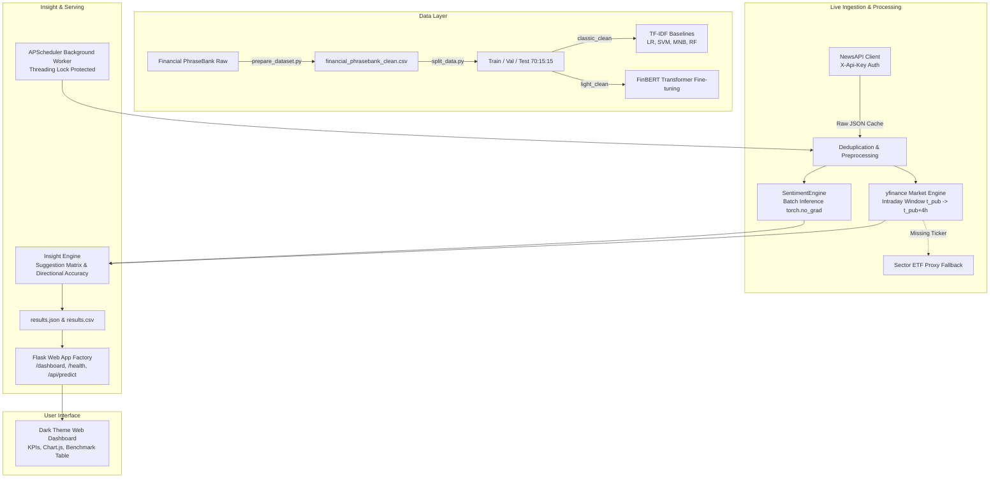

# 📊 Senti-Lytics: Financial News Sentiment & Market Reaction Dashboard

[](https://www.python.org/)
[](https://opensource.org/licenses/MIT)
[](tests/)

**Senti-Lytics** is an end-to-end financial intelligence platform that ingests real-time market headlines, analyzes sentiment using fine-tuned transformer models (FinBERT), tracks intraday stock price reactions centered on article publication timestamps, and generates heuristic trading insights (*Consider Buy*, *Consider Sell*, *Watch - delayed reaction*, *Hold*) on an interactive Flask dashboard.

---

## 🏛️ System Architecture



---

## ✨ Key Features

- 📰 **Secure News Ingestion**: Fetches company news using header-based authentication, 5xx retry logic, title deduplication, and targeted search queries with local JSON caching.
- 🤖 **Domain-Adapted FinBERT**: Classifies financial headlines with domain-tuned transformer weights, handling class imbalance via weighted cross-entropy.
- ⏱️ **Timestamp-Centric Price Reactions**: Tracks real price movement within a 4-hour window from the publication timestamp rather than naive daily closing prices.
- 🛡️ **Sector ETF Fallback**: Automatically substitutes sector ETF proxies (e.g., `XLK`) if specific company equity data is unavailable.
- 🧠 **Intelligent Suggestion Matrix**: Generates *Consider Buy*, *Consider Sell*, *Watch - possible delayed reaction*, and *Hold* signals.
- 🧪 **Deterministic Demo Mode**: Ships with built-in realistic synthetic test data for fully offline, zero-network presentations.
- 📊 **Honest Metrics**: Zero hardcoded accuracy claims—all statistics shown in the UI are dynamically loaded from verified training artifacts (`models/model_metrics.csv` or `metrics.json`).

---

## 🚀 Quick Start

### 1. Prerequisites
- Python 3.10, 3.11, or 3.12
- Git

### 2. Installation
```bash
# Clone the repository
git clone https://github.com/your-username/SentiLytics.git
cd SentiLytics

# Create and activate virtual environment
python -m venv .venv

# Windows
.\.venv\Scripts\activate
# Linux / macOS
source .venv/bin/activate

# Install core dependencies
pip install -r requirements.txt
```

### 3. Configuration
Copy the configuration template and environment file:
```bash
# Windows PowerShell
Copy-Item config_template.yaml config.yaml
Copy-Item .env.example .env

# Linux / macOS
cp config_template.yaml config.yaml
cp .env.example .env
```

Edit `.env` to add your [NewsAPI key](https://newsapi.org/):
```env
NEWSAPI_KEY=your_actual_newsapi_key_here
DEMO_MODE=False
```

*(Note: If you do not have a NewsAPI key, set `DEMO_MODE=True` to run the application entirely offline.)*

### 4. Running the Dashboard
```bash
# Run via module entrypoint
python -m src.api.app

# Or in Demo Mode (no API key or network required)
python -m src.api.app --demo
```

Open your browser at **`http://127.0.0.1:5000/`**.

---

## 💻 REST API Endpoints

| Endpoint | Method | Description |
|----------|--------|-------------|
| `/` | `GET` | Home landing page with portfolio snapshot |
| `/dashboard` | `GET` | Main interactive sentiment & market analytics dashboard |
| `/about` | `GET` | Technical methodology, architecture, and model documentation |
| `/health` | `GET` | System health check (model status, scheduler, data provenance) |
| `/api/results` | `GET` | Full current results JSON payload |
| `/api/summary` | `GET` | Per-company aggregate performance and sentiment breakdown |
| `/api/model_metrics`| `GET` | Benchmark comparison metrics across classical and transformer models |
| `/api/predict` | `POST` | Batch headline classification API: accepts `{"texts": ["headline 1", ...]}` |
| `/refresh` | `POST` | Triggers asynchronous background pipeline refresh (returns HTTP 202 or 409) |

---

## 🏋️ Training & Benchmarking

To train the models from scratch on the Financial PhraseBank dataset:

```bash
# 1. Parse raw Financial PhraseBank dataset into clean CSV
python -m src.preprocessing.prepare_dataset

# 2. Generate stratified 70/15/15 train/val/test splits
python -m src.preprocessing.split_data

# 3. Train and benchmark Classical ML models (LR, SVM, MNB, RF, Ensembles)
python -m src.models.baseline

# 4. Fine-tune FinBERT (domain-adapted sequence classification)
python -m src.models.transformer

# 5. Evaluate inference model against test set
python -m src.models.evaluate
```

### Paper Benchmark Suite (Optional)
If running the formal academic paper benchmark suite:
```bash
pip install -r requirements-benchmark.txt
python -m src.benchmark.classical
python -m src.benchmark.transformers_run --models bert finbert --smoke
```

---

## 🧪 Testing

Run the automated test suite with pytest:
```bash
pytest -v
```
All 49 unit and integration tests validate dataset parsing, text normalization, pricing heuristics, error handlers, and the Flask REST API.

---

## ⚠️ Known Limitations & Disclaimers

1. **NewsAPI Free-Tier Constraints**: The free developer tier allows approximately 100 requests per day, enforces a ~24-hour article publication delay, and is restricted to `localhost`.
2. **Market Price Correlation vs. Causality**: Short-term equity price movement is influenced by market-wide macroeconomic shifts (CPI, interest rates, sector beta) and unexpected corporate disclosures. Headline sentiment alone is an exploratory indicator, not a deterministic price driver.
3. **yfinance Availability**: Free intraday Yahoo Finance quote data may occasionally miss quotes for low-liquidity equities or outside official trading sessions. Senti-Lytics mitigates this using sector ETF proxy fallbacks (e.g., `XLK`).
4. **Dataset Scope**: The Financial PhraseBank comprises 2,264 sentences from financial news headlines. Performance on lengthy regulatory documents (10-K, 10-Q) may vary.
5. **Not Financial Advice**: All trading suggestions (*Consider Buy*, *Consider Sell*, *Watch*, *Hold*) generated by this platform are automated research heuristics designed for academic evaluation, not financial advice.

---

## 📸 Screenshots

*(Place application dashboard screenshots here)*
- `docs/screenshots/dashboard_dark.png` — Main Dark Theme Dashboard & KPI Strip
- `docs/screenshots/article_modal.png` — Article Detail Modal & Reaction Window
- `docs/screenshots/benchmark_table.png` — Verified Model Benchmark Comparison

---

## 📄 License
This project is licensed under the MIT License. See [LICENSE](LICENSE) for details.
